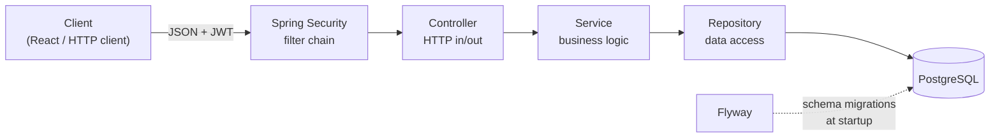

# CareerTrack

**CareerTrack** is a full-stack web application to keep track of job applications: companies, positions, full job descriptions, statuses and notes — so that when a recruiter calls back weeks later, every detail is one click away.

> 🚧 **Work in progress.** The REST API (backend) is functional; the React frontend is the next milestone.
 
---

## Table of contents

- [Features](#features)
- [Tech stack](#tech-stack)
- [Architecture](#architecture)

---

## Features

- **User accounts** — registration and login with email and password
- **JWT authentication** — stateless, token-based access to the API
- **Data isolation** — every user can only see and manage their own applications
- **Full CRUD for job applications** — company, position, job URL, full job description, location, work mode (on-site / hybrid / remote), status, application date and notes
- **Application lifecycle** — `TO_APPLY` → `APPLIED` → `INTERVIEW` → `OFFER` / `REJECTED` / `WITHDRAWN`
- **Input validation** with clear, field-level error messages
- **Standard error responses** following [RFC 9457 (Problem Details)](https://www.rfc-editor.org/rfc/rfc9457)
- **Versioned database schema** managed with Flyway

## Tech stack

| Layer | Technology |
|---|---|
| Language | Java 21 |
| Framework | Spring Boot 4.1 (Spring Framework 7) |
| Web | Spring Web MVC, Jakarta Bean Validation |
| Persistence | Spring Data JPA, Hibernate 7 |
| Database | PostgreSQL 17 (via Docker) |
| Migrations | Flyway |
| Security | Spring Security 7, OAuth2 Resource Server (JWT, HS256), BCrypt |
| Null safety | JSpecify (`@NullMarked`) |
| Build | Maven |
| Frontend *(planned)* | React + TypeScript (Vite) |

## Architecture

The backend follows a classic **layered architecture**: each layer has a single responsibility and only talks to the layer below it.

- **Controllers** handle HTTP requests and responses only.
- **Services** contain the business rules and transaction boundaries.
- **Repositories** (Spring Data JPA) handle database access.
- **DTOs** (Java records) decouple the API contract from the JPA entities: clients can never set server-managed fields (`id`, timestamps, owner), and sensitive data such as password hashes never leaves the server.